# IRIDE EAGLET-2 L1C to L1D processor

Turns an EAGLET-2 L1C RGB3 product into a new **L1D** product: the L1C layout,
with the colour-corrected RGB (true colour) in `IMG_DATA` in place of the L1C
image, and the cloud mask and cloud confidence map in `AUX_DATA`. Follows the
IRIDE Processor ICD (PDGS-ID-XPR-IRIDE-0209 v2.4). The input product is never
modified. Python 3.10 or newer. Runs on CPU only: no GPU is used, even on a
machine that has one.

Processor `EAGLET2_L1D_PROC`, task `EAGLET2_L1D`, version `01.02` (this
repository is `iride_eaglet_processor_v2`). The same version is written in
the STAC of every product it makes (`processing:software`).

## Run

```bash
python process_l1c.py <absolute path to JobOrder.xml>
```

The Job Order gives the product zip (`1CSP__RGB3`) and the logging level. The
colour correction uses the processor's own AUX file in `aux/`, unless the Job
Order also lists one (`AXE1D_CLUT`), which then overrides it. PDGS gives AUX
files zipped (`<ID>.zip` holding `<ID>/<ID>.xml` and its `<ID>/<ID>.hdr`): the
processor reads the XML in the zip, without unzipping it; an unzipped folder
or the bare XML work too. The AUX file is read and checked before anything
else, so an unusable one stops the run within seconds. The new product
is written as `<NEW_ID>.zip` next to the input zip, and the log then says
`OUTPUT_READY: <NEW_ID>.zip` (the name relative to the working directory, as
PDGS reads it). No network is used at runtime (model weights from
`hf_cache/omnicloudmask/`, see Installation and offline deployment). The
processor uses at most 2 CPU threads, the `Number_of_CPUs` of the Task Table,
on any machine, and writes only in the working directory (the folder of the
Job Order): temporary files and library caches go to a scratch folder there,
removed at the end.

| Exit code | Meaning |
|---|---|
| `0` | done |
| `255` | failure, including an unusable colour AUX file (there is no L1D image without one), missing model weights, and any error the processor does not catch itself (Python alone would exit with 1, which PDGS reads as "incomplete") |

At the end the log gives the time of each step, for example
`Processing times (s): unzip … | read + calibrate … | cloud mask … | colour correction … | COG writing … | quicklooks … | metadata … | rename + checksums … | zip … | total …`,
followed by the image size, the colour method and the number of CPU threads.

## What happens in a run

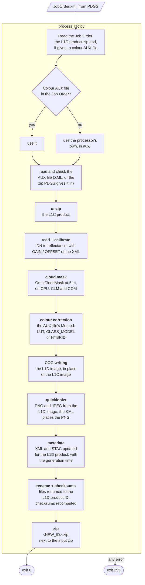

The names in bold are the steps timed in the log (`Processing times`).

## Output

`<NEW_ID>` is the input ID with `1CSP` changed to `1DSP`, the generation
time set to the time of the run, and the environment and processing baseline
(the last two parts, e.g. `O_A00`) taken from the Job Order (`Environment`,
`Processing_Baseline_1DSP__RGB3`). If the Job Order leaves one out or empty,
the L1C's is kept, with a warning; a value of the wrong form (not one capital
letter, not three capital letters or digits) stops the run with exit code 255.
Every file in the product is renamed to it, except files named after another
product (`AUX_DATA/*.anc.xml`).

| In the L1D product | Content |
|---|---|
| `IMG_DATA/<NEW_ID>.tif` | **the L1D image**: colour-corrected RGB (true colour), Cloud Optimized GeoTIFF, LZW with predictor (lossless), 512 x 512 tiles, internal overviews; uint16 = reflectance x 10000 + 1000 (Sentinel-2 L1C convention), 0 = no data; white where the L1C is saturated (see Colour correction). It replaces the L1C image |
| `AUX_DATA/<NEW_ID>.CLM.tif` | cloud mask, uint8: 0 no data, 1 clear, 2 thick cloud, 3 thin cloud, 4 cloud shadow. A pixel is cloud when its cloud confidence (the COM) is at least 0.5, thick or thin by whichever of the two is more likely; any other pixel is cloud shadow when OmniCloudMask finds shadow more likely than clear, clear otherwise. So the cloud in the CLM is exactly COM >= 5000 |
| `AUX_DATA/<NEW_ID>.COM.tif` | cloud confidence: OmniCloudMask's probability of thick plus thin cloud, uint16, x 10000 |
| `AUX_DATA/<NEW_ID>.CLM.json` | class legend |
| `<NEW_ID>.json` | STAC: L1D identity (`collection` `IME-1DSP-RGB3`, description and collection link "Level 1D" / "L1D", `processing:level` `L1D`, `processing:lineage` = the input L1C product ID, `processing:software` `{"Eaglet-2 Level 1D processor": "01.02"}`); `eo:cloud_cover`; assets `clm`, `com`, `clm_aux`; the `rgb` asset describes the L1D image (title "Eaglet-2 Level 1D", band descriptions "Level-1D ...", COG media type, `raster:scale` 0.0001, `raster:offset` -0.1, `nodata` 0, method and AUX file) and its render range is recomputed (each band from its 2nd percentile, over one span for the three bands, the 98th percentile of the three after it; saturated pixels left out); `quicklook` points to the PNG and `thumbnail` to the JPEG (the reverse of the L1C); new id and times; `file:checksum` / `file:size` of every asset recomputed |
| `<NEW_ID>.xml` | the L1C XML as in Enrico's L1D template (12 Oct 2026): `PRODUCT_ID` = `<NEW_ID>`, `PROCESSING_LEVEL` `L1D`, `GENERATION_TIME` = the generation time of the run (as in the product name and the STAC), `AUXILIARY_FILE` = only the colour AUX file used (name without `.xml` or `.zip`), `INPUT_PRODUCTS` = the input L1C zip, `Processor_Version` `01.02`; `Rescaling_Factors` (GAIN 0.0001, OFFSET -0.1) and the image SHA-256 set for the L1D image. Everything else as in the L1C, as the template asks: element names (Level-1C), outliers, RPC |
| `PREVIEW/*` | PNG and JPEG drawn from the L1D image, with the same names, formats and sizes as in the L1C product. They use the STAC render range, then a gamma of 1.6: each band starts at its own dark level, which takes away the haze of top-of-atmosphere colour (the blue cast), and the three bands share one span, which keeps the colours of the correction. Saturated clouds show white. The PNG is RGBA, transparent where there is no data; the JPEG has no transparency, so no data is black there. The KML places the PNG on the map (the L1C one places the JPEG) |

Files that are already compressed (`.tif`, `.png`, `.jpg`) are stored in the
zip without compressing them again.

## Colour correction

EAGLET-2 band 1 picks up about 40% near-infrared, so vegetation looks purple.
The colour step brings the colours towards Sentinel-2 L1C. It runs after the
cloud mask, at full resolution, tile by tile, on the product's own grid.

**Input:** reflectance = DN x GAIN + OFFSET, with GAIN and OFFSET from the
L1C product XML (`Rescaling_Factors`, correct from 24 September 2026). The
rounded `raster:scale` of the STAC file is only a fallback. DN = 0 is no data.

**Saturation:** where the L1C is saturated (DN 65535, the top of the uint16
range, in any band; the bright cores of clouds), the pixel has lost its
colour. Each band's GAIN turns the same clipped DN into a different
reflectance, blue highest, which looks purple. The L1D writes such a pixel
white: its three bands at the highest of its three reflectances. The log gives
the number of saturated pixels, and the image's `SATURATED` tag the rule.

**Configuration:** one AUX file,
`IME___AXE1D_CLUT_20240101T000000_20990101T000000_<created>____________O_001.xml`,
with the LUT, Enrico's model and `<Method>`, which selects what the processor
applies. The LUT is the same for every product, so the processor carries the
file in `aux/` and uses it by default (the newest there, by the creation time
in the name). To change the LUT or the method in operations, PDGS can give a
newer file in the Job Order as an `AXE1D_CLUT` input: it overrides the
processor's own, with no new Docker image, as long as the file keeps the same
layout (the same tables and axes). PDGS hands it over as it archives AUX files,
`<ID>.zip` holding `<ID>/<ID>.xml` and its header `<ID>/<ID>.hdr`; the
processor reads the XML in the zip. The file used is named, without `.xml` or
`.zip`, in the log, in the image's tags, in the XML's `AUXILIARY_FILE` and in
the STAC description.

| `<Method>` | What it does | Brightness |
|---|---|---|
| `LUT` | colour balance, then a look-up table on ln(b1/b2), ln(b3/b2) and the share of vegetation in the ~70 m around each pixel; one table for the whole constellation | as delivered |
| `CLASS_MODEL` | Enrico Cadau's model (`applica_L1C_RGB.py` v2, stored unchanged): water / vegetation / built-up weights from Gaussian mixtures on the RGB triplet, one transform per class | close to Sentinel-2 |
| `HYBRID` | Enrico's colour where his model sees vegetation or water inside its training range, the LUT elsewhere | as delivered |

To switch method, edit `<Method>` in the file (the processor's own, or one
given in the Job Order). The tables and the model are protected by SHA-256
checksums, `<Method>` is not. A file without `<Method>` (version 3) works as
`LUT`.

The built-in AUX file holds the LUT fitted on the A01 products with OHB's
corrected coefficients: seven products of 17 and 18 Oct 2026, from IME01,
IME02, IME03, IME04 and IME08, fitted on 19 Oct 2026. OHB changed the
radiometry with A01, and the LUT fitted on A00 products no longer fits it; the
first A01 products (13 to 15 Oct) had calibration problems and were not used.
One colour balance fits every satellite measured (IME01 to IME04): a balance
per satellite does no better. The LUT is fitted offline with
`tools/build_lut.py`, a local tool that is not part of this repository:
Sentinel-2 L1C within 3 days of each product (6 when that leaves less than
half of it clear), EAGLET fitted onto it, the near-infrared share of each band
and the colour balance of the delivered calibration measured on the pixel
pairs, and the table trained on Sentinel-2 alone (world chips and the product
footprints). It writes the new AUX file from the current one, keeping Enrico's
model and `<Method>`.

## Examples

### The A01 LUT

The built-in LUT against Sentinel-2 L1C, on the seven A01 products it was fitted on (mean of the seven):

| | Colour error (CIELAB dE, lower is better) | Vegetation shown green |
|---|---|---|
| as delivered | 9.08 | 34% |
| previous LUT (7 Oct, fitted on A00 products) | 20.1 | 72% |
| **A01 LUT, one balance (built in)** | **7.42** | **86%** |
| A01 LUT, a balance per satellite (not used) | 7.37 | 83% |

Each product side by side: as delivered, previous LUT, A01 LUT, A01 LUT with a balance per satellite, Sentinel-2 L1C. Made with `tools/lut_previews.py` before the A01 LUT was installed, so "current LUT" in the titles is the previous one.

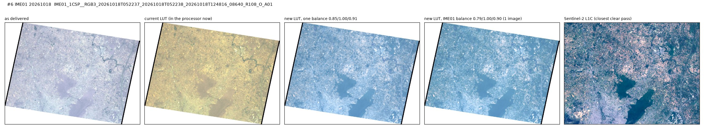

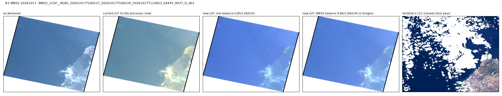

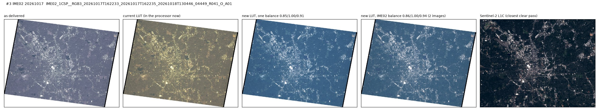

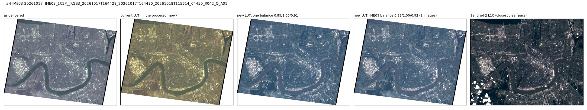

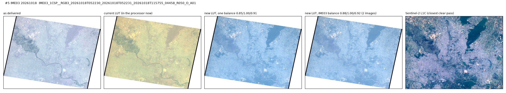

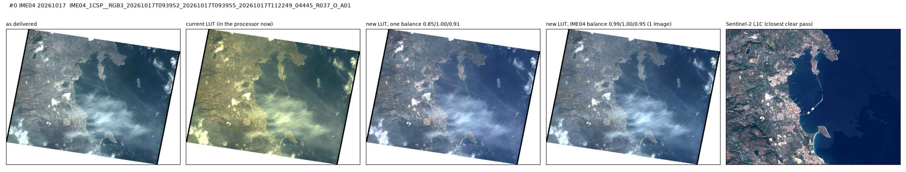

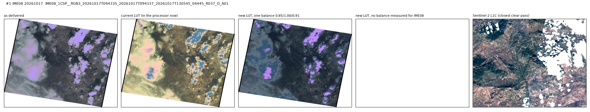

2 km crops at 10 m, the same display for all (reflectance 0 to 0.3):

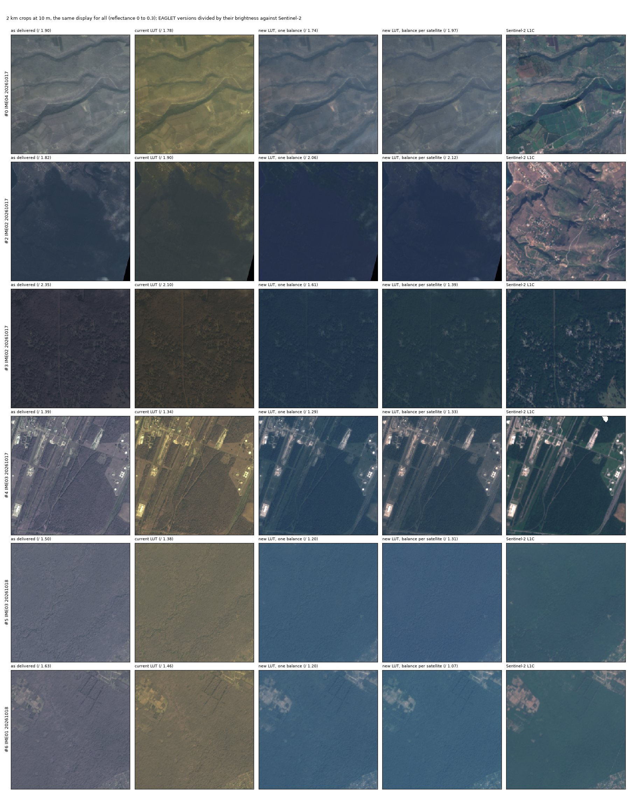

### An L1D made with 01.01

IME03, 17 Oct 2026, made by the 01.01 Docker image run as PDGS runs it: the quicklook, then the L1D image with its cloud mask (CLM: red thick cloud, orange thin cloud, blue shadow) and cloud confidence (COM).

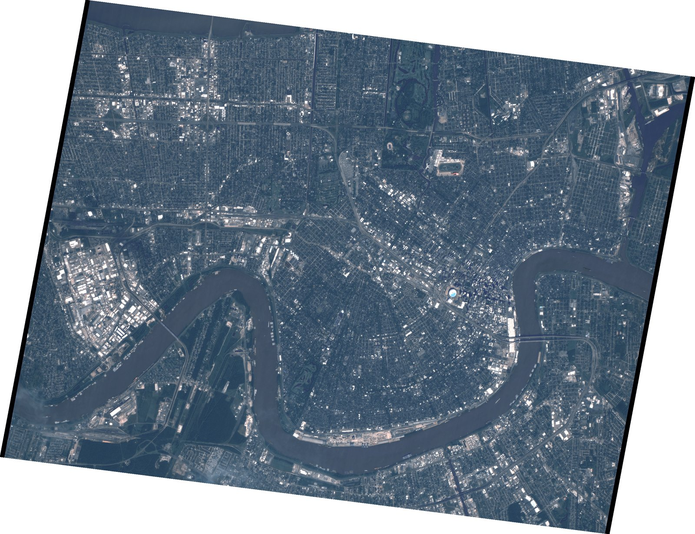

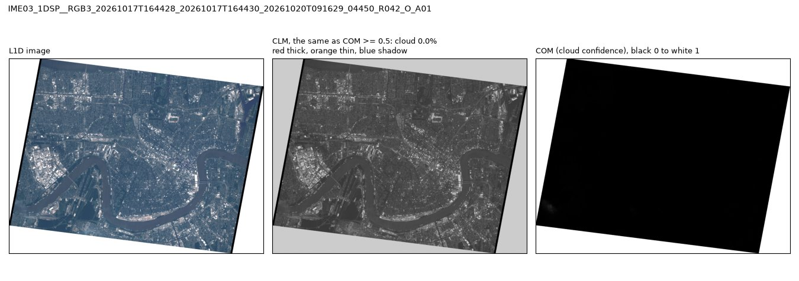

The pictures are in `docs/images/`, which `.gitattributes` leaves out of `git archive`: they are not in the Docker build context, nor in GitHub's "Download ZIP".

## Installation and offline deployment

```bash
pip install -r requirements.txt
python download_models.py           # once, with internet: OmniCloudMask weights into hf_cache/omnicloudmask/
```

The processor reads the model weights from `hf_cache/omnicloudmask/`. Left to
itself, OmniCloudMask would look for them in the home folder of the user
running it and download them when missing; in PDGS the processor runs as a
user without a home folder and without network. `process_l1c.py` also sets
`HF_HOME=<repository>/hf_cache` and `HF_HUB_OFFLINE=1` itself, so it never
goes online. Without the weights it stops with exit code 255.

For PDGS the processor is delivered as a Docker image (next section). Without
Docker, ship `hf_cache/` and `aux/` with the code:

```bash
zip -r iride_eaglet_processor_deploy.zip process_l1c.py job_order.py pdgs_logger.py \
    product_naming.py task_table.xml requirements.txt src/ aux/ hf_cache/
```

## Docker image

PDGS runs the processor as a Docker (OCI) image (ICD Appendices D, E and F),
built the way PDGS built the previous version: `docker/Dockerfile-e2l1d-trixie`
follows that build (`Dockerfile-e2cp-trixie`, image `ipf-ime-msi-l1cc:01.00`),
with the same production base image (`python:3.14.8-slim-trixie`), user
(`opiride`, 1100:600), virtual environment and folders. Its build context is
the repository as a zip (`iride_eaglet_processor_v2-main.zip`, as GitHub's
"Download ZIP" of main), the package list
(`docker/Eaglet-2-L1D-requirements-trixie.txt`: the one of that build, plus
scipy) and the two model weights, which go to `hf_cache/omnicloudmask/` of the
repository in the image. Nothing is downloaded at run time. PDGS starts it with
its own wrapper script, as:

```bash
docker run --user 1100:600 --cpus 2 -v <WD>:<WD>:rw -w <WD> ... \
    ipf-ime-msi-l1d:01.02 EAGLET2_L1D <WD>/JobOrder.<id>.xml
```

`EAGLET2_L1D`, the entry point, is a link to `process_l1c.py`, which runs in
the image's virtual environment
(`/opt/ipf-ime-msi-l1d/iride_eaglet_processor_v2-main/process_l1c.py` works
too).

Build, test and save for delivery, on a machine with Docker and internet,
after `python download_models.py`:

```bash
docker/build_image.sh                                 # image ipf-ime-msi-l1d:01.02
docker/test_image.sh <L1C zip> [<reference L1D zip>]  # runs it as PDGS does and checks the result
docker/build_image.sh --save                          # dist/IPF-IME-MSI-L1D-01.02.tar.gz and its SHA-256
```

`docker/build_image.sh` makes the build context in `dist/build/` (the zip is
made from this checkout, with any changes not yet committed), builds the image
and checks in it, as user 1100 and offline, that the processor imports and the
models run. The image tag is the processor version in `task_table.xml`.
`docker/test_image.sh` runs the image as user 1100:600 with only the working
directory mounted and the Task Table's CPUs, and also with no network and a
read-only file system, so any download, or any file written outside the
working directory, makes it fail. Its Job Order gives the colour AUX file as
PDGS does, zipped with a `.hdr` (the newest in `aux/`; `AUX=<.xml or .zip>`
gives another, `AUX=none` none, so the processor uses its own), and the input
product's processing baseline for the L1D name (`BASELINE` sets another). It
then checks the exit code, the log, the AUX file used, the output's name, owner
and content and, given an L1D zip made from the same
product with the same colour method, that the L1D image has the same pixels
(compared in the image). Its working directory is under
`/var/tmp/eaglet2_l1d_test` (`TEST_ROOT` changes it; not under `/root`, which
user 1100 cannot enter).

## PDGS interfaces

| Interface | File | ICD section |
|---|---|---|
| Task Table | `task_table.xml` | 3.1.1 |
| Job Order | `job_order.py` | 3.1.2 |
| Logging (one line per message, stdout / stderr) | `pdgs_logger.py` | 3.1.4 |
| Exit codes | `process_l1c.py` | 3.1.5 |
| Docker image, entry point | `docker/Dockerfile-e2l1d-trixie` | Appendices D, E, F |

The processor never scans its working folder: every path comes from the Job
Order.

## Files

```
process_l1c.py              entry point
job_order.py                Job Order parsing (inputs told apart by File_Type)
pdgs_logger.py              PDGS log format
product_naming.py           L1C -> L1D names, product rename
download_models.py          fills hf_cache/omnicloudmask/ (once, with internet)
task_table.xml              processor definition for PDGS
requirements.txt
aux/                        the colour AUX file used by default (LUT + Enrico's model + Method)
src/iride_eaglet_processor/
    raster_reader.py        reads the product
    calibration.py          GAIN / OFFSET from the product XML (STAC fallback); L1D values into the XML
    footprint.py            valid pixels
    resampling.py           to and from the 5 m inference grid
    inference.py            OmniCloudMask, with the weights in hf_cache/omnicloudmask/
    masks.py                CLM and COM rasters
    stats.py                cloud statistics
    metadata.py             STAC sidecar (L1D identity, L1D image, cloud outputs, previews, checksums), CLM legend
    product_xml.py          L1D header of the product XML (Enrico's template)
    colour_correction.py    LUT, class model, hybrid; the L1D image writer (COG)
    previews.py             quicklook (PNG, transparent no data) and thumbnail (JPEG) from the L1D image
docs/images/                pictures in this README (not in the Docker build: .gitattributes)
docker/
    Dockerfile-e2l1d-trixie               the Docker image for PDGS, in the format of the PDGS build
    Eaglet-2-L1D-requirements-trixie.txt  its Python packages
    build_image.sh                        builds the image (and, with --save, the archive for delivery)
    test_image.sh                         validation: runs the image as PDGS does and checks the result
```

## Acknowledgements

Cloud masking by [OmniCloudMask](https://github.com/DPIRD-DMA/OmniCloudMask)
(MIT License).

## Development notes

Parampuneet Kaur Thind develops the processor: what was
decided with Enrico Cadau (ESA ESRIN) and, for PDGS, with Claudio Nasuti (Exprivia), and what is still open.

Decided:

- With Enrico (13 Oct 2026): the AUX files of the L1C stay as they are in
  `AUX_DATA`; `AXE1D_CLUT` is the file type in `AUXILIARY_FILE`; the XML keeps
  the `Rescaling_Factors` of the L1D image.
- With Enrico (14 Oct 2026): the L1D name takes the environment and
  processing baseline from the Job Order.
- The processor runs on L1C products of processing baseline A01, the new
  radiometry from OHB (October 2026). Its built-in LUT is fitted on the A01
  products with OHB's corrected coefficients (19 Oct 2026); the first A01
  products (13 to 15 Oct) had calibration problems, so no LUT was installed
  from them. PDGS sends a new colour AUX file through the Job Order once in a
  while.
- The Docker build follows the PDGS build of the previous version (Claudio,
  13 Oct 2026); see Docker image.
- With Enrico (15 Oct 2026): the colour AUX file stays out of the L1D's
  `AUX_DATA`; the L1D names it in the XML's `AUXILIARY_FILE` and in the STAC.
- `Number_of_CPUs` is 2, about 4 to 5 minutes per product (confirmed
  15 Oct 2026).
- The documents of ICD Appendix D (processor ICD, release note, user manual)
  are not needed for now.
- With Enrico (20 Oct 2026): version 01.01, so that a new LUT can go to PDGS
  as an AUX file alone. PDGS gives AUX files zipped (`<ID>.zip` holding
  `<ID>/<ID>.xml` and its `.hdr`), and 01.00 could read only the bare XML: its
  first PDGS run with an AUX file in the Job Order (20 Oct) stopped with exit
  code 255, after the cloud mask. 01.01 reads the XML in the zip, and checks
  the AUX file before anything else. The task version stays 01.00, so PDGS's
  Job Orders do not change.
- Cloud mask (19 Oct 2026, after Enrico's check of 16 Oct on a PDGS L1D): a
  pixel is cloud when its cloud confidence (COM, thick plus thin cloud) is at
  least 0.5. Before, each pixel took the most likely of OmniCloudMask's four
  classes, which left clear the clouds whose probability was split between
  thick and thin (clear 0.4, thick 0.3, thin 0.3 is 0.6 cloud).
- Feedback on the first L1D panels (21 Oct 2026), version 01.02: the
  quicklook takes each band from its own dark level (the haze, largest in
  blue) over one span for the three bands, with a gamma of 1.6, instead of one
  stretch for the three bands, which left the L1D bluish (a stretch of each
  band to its own top re-balanced the colours: a large thin cloud turned
  green); and clouds saturated in the L1C are white in the L1D, not purple.
  The L1D image is unchanged except at saturated pixels.

Open items:

- `File_Type` codes: `1CSP__RGB3` in, `1DSP__RGB3` out, `AXE1D_CLUT` for the
  optional colour AUX file that overrides the built-in one, with its `Origin`
  and `Retrieval_Mode`.
- Docker image name: `ipf-ime-msi-l1d`, after the PDGS name of the previous
  version (`ipf-ime-msi-l1cc`); to confirm with PDGS.
- `Executable_File_Name` in `task_table.xml`: the path of PDGS's wrapper
  script, which PDGS integration fills in (ICD Appendices E and F). The Task
  Table has `/opt/iride/iride-pdgs-ipf-prom-ttsc/ime/scripts/eaglet2-l1d-processor`
  as a proposal.