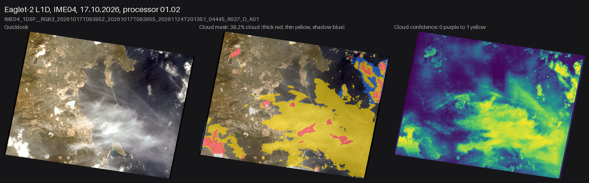
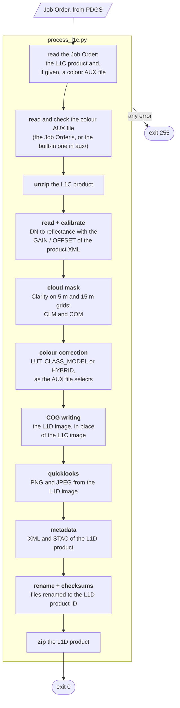

# Eaglet-2 L1D Processor

The **EAGLET2_L1D** processor of the IRIDE ground segment (PDGS) turns an Eaglet-2 **L1C RGB3** product into an
**L1D** product:

- the **L1D image**: true-colour RGB, colour-corrected towards Sentinel-2 L1C, as a Cloud Optimized GeoTIFF;
- a **cloud and cloud-shadow mask** (CLM) and its **cloud confidence** (COM), from **Clarity**, a
  sensor-agnostic cloud model;
- new **quicklooks**, **XML** and **STAC** for the L1D product.

It runs in the PDGS as a Docker image: one Job Order in, one L1D product out, on CPU only and offline. Its
interfaces (Task Table, Job Order, log format, exit codes and Docker image) follow the IRIDE PDGS documentation for
processors.

| | |
|---|---|
| Processor | `EAGLET2_L1D_PROC`, version **01.02** (task `EAGLET2_L1D`, version 01.00) |
| Input | L1C RGB3 product (`1CSP__RGB3`); optionally a colour AUX file (`AXE1D_CLUT`) |
| Output | L1D product (`1DSP__RGB3`), next to the input |
| Docker image | `ipf-ime-msi-l1d:01.02` (Python 3.14, Debian trixie) |
| Resources | 2 CPU threads, no GPU, no network; about 6.5 to 9.5 minutes per product |



## Contents

- [How it works](#how-it-works)
- [Running the processor](#running-the-processor)
- [The L1D product](#the-l1d-product)
- [Cloud mask](#cloud-mask)
- [Colour correction](#colour-correction)
- [Installation](#installation)
- [Docker image](#docker-image)
- [Tests](#tests)
- [Repository layout](#repository-layout)
- [Version history](#version-history)
- [Project](#project)

## How it works



The steps in bold are timed in the log (`Processing times`).

## Running the processor

```bash
python process_l1c.py <absolute path to the Job Order>
```

In the PDGS the processor runs inside its Docker image, started by the PDGS wrapper script:

```bash
docker run --user 1100:600 --cpus 2 -v <WD>:<WD>:rw -w <WD> \
    ipf-ime-msi-l1d:01.02 EAGLET2_L1D <WD>/JobOrder.<id>.xml
```

- **Inputs** come only from the Job Order: the L1C product zip, the logging level, the environment and processing
  baseline of the output name, and optionally a colour AUX file. The working directory is never scanned.
- **Output**: `<NEW_ID>.zip` next to the input zip, announced in the log as `OUTPUT_READY: <NEW_ID>.zip`. The input
  product is never modified.
- **Log**: one line per message in the PDGS format, on stdout (debug, info, progress) and stderr (warning, error).
  At the end it gives the time of each step.
- **Resources**: at most 2 CPU threads (`Number_of_CPUs` of `task_table.xml`) on any machine, no GPU, no network.
  The processor writes only in the working directory; its temporary files go to a scratch folder there, removed at
  the end.

| Exit code | Meaning |
|---|---|
| `0` | done |
| `255` | failure, including an unusable colour AUX file, a missing or altered cloud model package, and any error the processor does not catch itself |

## The L1D product

`<NEW_ID>` is the L1C product ID with `1CSP` changed to `1DSP`, the generation time set to the time of the run, and
the environment and processing baseline (the last two parts, e.g. `O_A01`) taken from the Job Order (`Environment`,
`Processing_Baseline_1DSP__RGB3`). The product keeps the L1C layout, with every file renamed to `<NEW_ID>`:

| File | Content |
|---|---|
| `IMG_DATA/<NEW_ID>.tif` | **the L1D image**, in place of the L1C image: colour-corrected RGB, Cloud Optimized GeoTIFF (LZW, 512 x 512 tiles, internal overviews), uint16 = reflectance x 10000 + 1000 (the Sentinel-2 L1C convention), 0 = no data |
| `AUX_DATA/<NEW_ID>.CLM.tif` | cloud mask, uint8: 0 no data, 1 clear, 2 thick cloud, 3 thin cloud, 4 cloud shadow |
| `AUX_DATA/<NEW_ID>.COM.tif` | cloud confidence: the probability of thick plus thin cloud, uint16, x 10000 |
| `AUX_DATA/<NEW_ID>.CLM.json` | the CLM class legend |
| `<NEW_ID>.json` | STAC item: L1D identity (`IME-1DSP-RGB3`, `processing:level` L1D, `processing:lineage` the L1C, `processing:software` the processor version), `eo:cloud_cover`, the `clm`, `com` and `clm_aux` assets, the `rgb` asset describing the L1D image and its display range, the previews, checksums and sizes |
| `<NEW_ID>.xml` | the L1C XML with the L1D header (`PRODUCT_ID`, `PROCESSING_LEVEL`, `GENERATION_TIME`, `AUXILIARY_FILE`, `INPUT_PRODUCTS`, `Processor_Version`), the `Rescaling_Factors` of the L1D image and its SHA-256 |
| `PREVIEW/<NEW_ID>.QLK.*` | PNG (transparent where there is no data) and JPEG drawn from the L1D image, with the names, formats and sizes of the L1C previews; the KML places the PNG |

The quicklooks use the display range of the STAC item: each band starts at its own dark level, which takes away the
haze of top-of-atmosphere colour, the three bands share one span, which keeps the colours of the correction, and a
gamma of 1.6 brightens the result.

## Cloud mask

**Clarity** reads the scene in reflectance, on a 5 m grid, in tiles of 240 x 240 pixels every 120 pixels, blended so
that no tile edge shows; then again on a 15 m grid, which finds wide haze and overcast, and averages the two readings.
It gives four probabilities per pixel: clear, thin cloud, thick cloud and cloud shadow. The processor turns them into
its two layers at full resolution:

- **CLM**: a pixel is cloud when its cloud confidence is at least 0.5, thick or thin by whichever of the two is more
  likely; any other pixel is cloud shadow when shadow is more likely than clear, clear otherwise. So the cloud of the
  CLM is exactly COM >= 5000, and `eo:cloud_cover` is its share of the valid pixels.
- **COM**: the probability of thick plus thin cloud.

The model is a package of two TorchScript networks (float32), read from `models/clarity_eaglet2_fp32/` and checked
against the package's `SHA256SUMS` at every run (see [`models/README.md`](models/README.md)).

## Colour correction

Eaglet-2 band 1 picks up about 40% near-infrared, so vegetation looks purple. The colour step brings the colours
towards Sentinel-2 L1C. It runs at full resolution, tile by tile, on reflectance = DN x GAIN + OFFSET, with GAIN and
OFFSET from the `Rescaling_Factors` of the L1C product XML.

| `<Method>` | What it does | Brightness |
|---|---|---|
| `LUT` | a colour balance, then a look-up table on ln(b1/b2), ln(b3/b2) and the share of vegetation in the ~70 m around each pixel; one table for the whole constellation | as delivered |
| `CLASS_MODEL` | the class model: water, vegetation and built-up weights from Gaussian mixtures on the RGB triplet, one transform per class | close to Sentinel-2 |
| `HYBRID` | the class model where it sees vegetation or water inside its training range, the LUT elsewhere | as delivered |

**Saturated pixels.** Where the L1C is saturated (DN 65535 in any band, the bright cores of clouds), the bands'
gains turn the same clipped value into different reflectances, which shows as purple. The L1D writes such a pixel
white, its three bands at the highest of its reflectances; the log gives their number.

**Configuration.** Everything the colour step uses is in one colour AUX file (`AXE1D_CLUT`, Earth Explorer XML):
the LUT, the class model and `<Method>`, which selects one. The processor carries its own in [`aux/`](aux/),
`IME___AXE1D_CLUT_20261017T000000_20990101T000000_20261019T112255____________O_001`, valid from 17 Oct 2026. A
colour AUX file given in the Job Order overrides it, bare or zipped as PDGS archives AUX files, so a new LUT reaches
operations without a new Docker image. The tables and the class model are protected by SHA-256 checksums; the file
used is named in the log, in the image's tags, in the XML's `AUXILIARY_FILE` and in the STAC.

The built-in LUT was fitted on seven A01 products of 17 and 18 Oct 2026 (IME01 to IME04 and IME08) against
Sentinel-2 L1C:

| | Colour error (CIELAB dE, lower is better) | Vegetation shown green |
|---|---|---|
| as delivered | 9.08 | 34% |
| previous LUT (fitted on A00 products) | 20.1 | 72% |
| **A01 LUT (built in)** | **7.42** | **86%** |

The products side by side with Sentinel-2 are in [`docs/colour_lut.md`](docs/colour_lut.md). The LUT is fitted
offline with the tools in [`tools/`](tools/README.md).

## Installation

Python 3.10 or newer:

```bash
pip install -r requirements.txt
cd models && unzip clarity_eaglet2_fp32_20261124.zip    # the cloud model package, see models/README.md
```

The cloud model package is not in this repository; the processor stops with exit code 255 without it.

## Docker image

The image follows the PDGS build of the previous Eaglet-2 processor: the same production base image, user
(`opiride`, 1100:600), virtual environment and folders. The base image, `python:3.14.8-slim-trixie`, is pinned by
digest to the copy 01.01 was built on, so its system libraries match 01.01's.
`EAGLET2_L1D`, the entry point, runs `process_l1c.py`. Nothing is downloaded at run time.

On a machine with Docker and internet, with the cloud model package unzipped in `models/`:

```bash
docker/build_image.sh                                 # builds ipf-ime-msi-l1d:<version of task_table.xml>
docker/test_image.sh <L1C zip> [<reference L1D zip>]  # runs it as PDGS does and checks the result
docker/build_image.sh --save                          # dist/IPF-IME-MSI-L1D-<version>.tar.gz and its SHA-256
```

- `build_image.sh` makes the build context in `dist/build/` (the repository as a zip, the pinned package list
  [`docker/Eaglet-2-L1D-requirements-trixie.txt`](docker/Eaglet-2-L1D-requirements-trixie.txt) and the cloud model
  package), builds the image and checks in it, as user 1100 and offline, that the processor imports and the cloud
  model runs. It also writes the image's package list to `dist/`.
- `test_image.sh` runs the image as user 1100:600 with only the working directory mounted and the Task Table's
  CPUs, and stricter than PDGS: with no network and a read-only file system. It checks the exit code, the log, the
  output's name, owner and content, the XML and the STAC and, given a reference L1D of the same product, that the
  L1D image has the same pixels.

## Tests

```bash
python -m pytest tests/
```

## Repository layout

```
process_l1c.py              the processor (entry point)
task_table.xml              the processor's Task Table for PDGS
requirements.txt            Python packages (the image pins them in docker/)
aux/                        the built-in colour AUX file
models/README.md            where the cloud model package goes (not in git)
src/iride_eaglet_processor/
    job_order.py            Job Order
    pdgs_logger.py          PDGS log format
    product_naming.py       L1C -> L1D product ID, renaming
    raster_reader.py        reads the product
    calibration.py          GAIN / OFFSET of the product XML; L1D values into the XML
    footprint.py            valid pixels
    resampling.py           to and from the cloud model's grid
    inference.py            the cloud model (Clarity), checked against its SHA256SUMS
    masks.py                CLM and COM
    stats.py                cloud statistics
    colour_correction.py    LUT, class model, hybrid; the L1D image (COG)
    previews.py             quicklooks from the L1D image
    product_xml.py          L1D header of the product XML
    metadata.py             STAC item of the L1D product
docker/                     the Docker image: Dockerfile, pinned packages, build and test scripts
tests/                      unit and product tests (pytest)
tools/                      offline tools: LUT fitting, comparisons and panels (tools/README.md)
docs/                       pictures, the LUT examples and the VH-RODA poster
```

`docs/`, `tools/` and `tests/` are left out of `git archive` (`.gitattributes`), so they are not in the Docker build
context.

## Version history

| Version | Date | Changes |
|---|---|---|
| 01.02 | 24 Nov 2026 | cloud mask by Clarity; saturated pixels white; new quicklook stretch; lower memory peak; built-in colour AUX file valid from 17 Oct 2026 |
| 01.01 | 20 Oct 2026 | reads the colour AUX file as PDGS gives it (zipped) and checks it first; cloud where the cloud confidence is at least 0.5; the A01 LUT built in |
| 01.00 | Oct 2026 | first version for PDGS |

Details in [`CHANGELOG.md`](CHANGELOG.md).

## Project

- Project supervisor: Enrico Cadau (ESA ESRIN), author of the class model of the colour correction.
- PDGS integration: Claudio Nasuti (Exprivia).
- The processor and Clarity are developed by Parampuneet Kaur Thind.

The LUT is fitted on Copernicus Sentinel-2 data.
