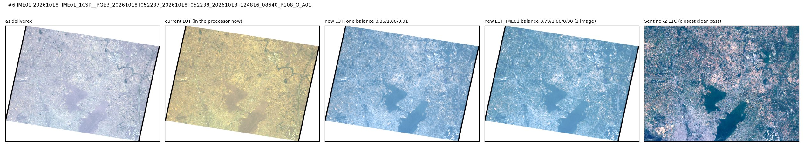
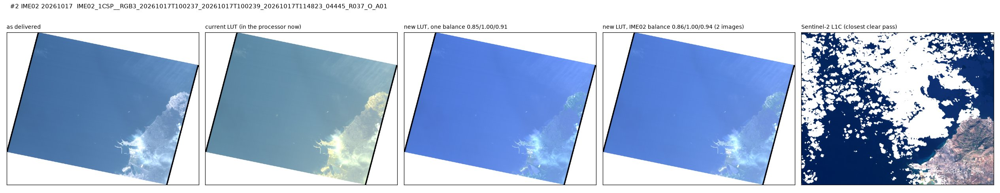
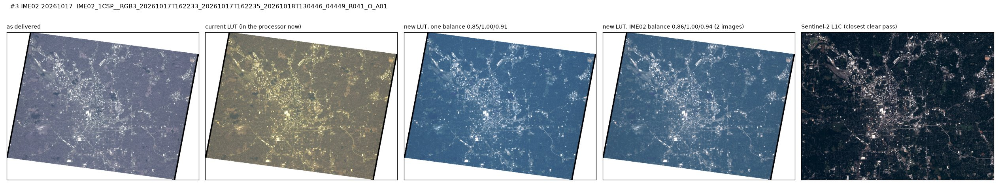
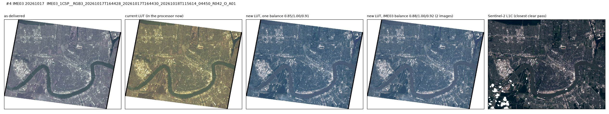
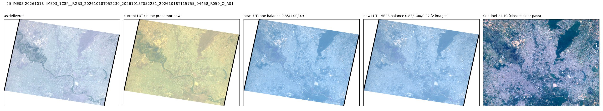
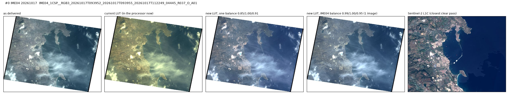
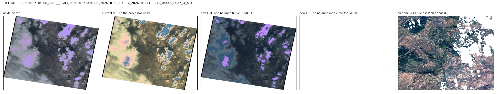
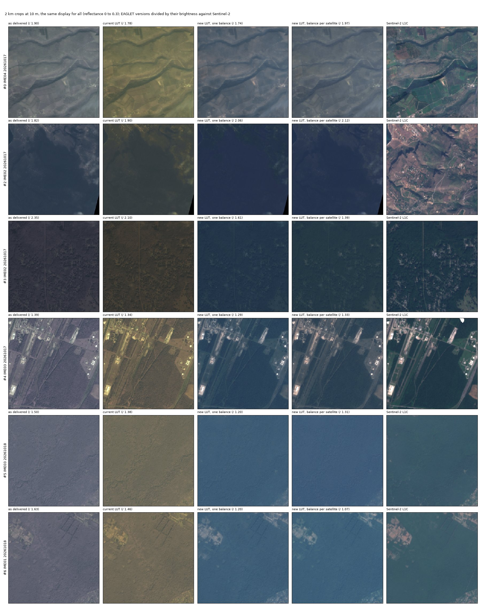

# The A01 colour LUT

The built-in LUT (`aux/`) against Sentinel-2 L1C, on the seven A01 products it was fitted on (mean of the seven):

| | Colour error (CIELAB dE, lower is better) | Vegetation shown green |
|---|---|---|
| as delivered | 9.08 | 34% |
| previous LUT (7 Oct 2026, fitted on A00 products) | 20.1 | 72% |
| **A01 LUT, one balance (built in)** | **7.42** | **86%** |
| A01 LUT, a balance per satellite (not used) | 7.37 | 83% |

One colour balance fits every satellite measured (IME01 to IME04): a balance per satellite does no better.

How it was fitted (`tools/build_lut.py`): Sentinel-2 L1C within 3 days of each product (6 when that leaves less than
half of it clear), Eaglet-2 aligned onto it, the near-infrared share of each band and the colour balance of the
delivered calibration measured on the pixel pairs, and the table trained on Sentinel-2 alone (world chips and the
product footprints). The new AUX file is written from the current one, keeping the class model and `<Method>`.

Each product side by side: as delivered, previous LUT, A01 LUT, A01 LUT with a balance per satellite, Sentinel-2
L1C. Made with `tools/lut_previews.py` before the A01 LUT was installed, so "current LUT" in the titles is the
previous one.

2 km crops at 10 m, the same display for all (reflectance 0 to 0.3):

